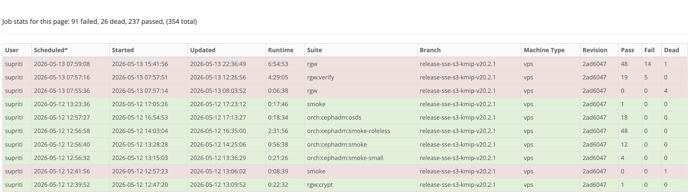

# Release Notes: RGW SSE-S3 KMIP

- Base: Ceph v20.2.1 (Tentacle) + 1 backport branch (12.05.2026)
- Image: http://harbor.clyso.com/custom-ceph/ceph/ceph:gridscale-v20.2.1-sse-s3-kmip-v1
- Branch: https://github.com/clyso/ceph-dev/tree/release-sse-s3-kmip-v20.2.1
- PR: https://github.com/ceph/ceph/pull/69258

## Overview

This branch adds support for SSE-S3 with KMIP in RGW. Object encryption keys
(DEKs) are wrapped by a per-bucket key-encryption key (KEK) provisioned on an
external KMIP-compliant key manager.

## New configuration options

When `rgw_crypt_sse_s3_backend=kmip`, two additional configuration options
become applicable. Default values are intentionally conservative and may not
be optimal for production load. Operators are expected to tune these against
their KMIP server's capacity.

| Option                                 | Type | Default | Range | Description                                                              |
|----------------------------------------|------|---------|-------|--------------------------------------------------------------------------|
| `rgw_crypt_kmip_worker_threads`        | int  | 1       | 1–32  | Number of parallel KMIP client worker threads.                           |
| `rgw_crypt_kmip_socket_io_timeout_sec` | int  | 300     | 0–300 | Per-socket `SO_RCVTIMEO` / `SO_SNDTIMEO` on KMIP TLS connections.        |

## Testing

### Unit tests

The unit test suite was executed against the release branch via
`build_container.py`. All tests passed.

### Teuthology

SSE-S3 validation is performed primarily through the `rgw:crypt` teuthology
test suite, which exercises both SSE-KMS and SSE-S3 code paths. All tests
pass. Remaining test failures are documented in [Known Issues](#known-issues).

### Smoke test

A custom smoke-test script (`test_sse.py`) was run against the
customer-provided OKMS. All checks passed.

### Soak test

A long-running customised soak script (`soak_test.py`) was executed using a
concurrent mixed workload against the customer-provided OKMS instance. No
data corruption reported.

### Production environment

The release image was deployed in the CLYSO production environment (with S3
workload) for a week. No issues observed.

## Known issues

Based on the CLYSO internal Teuthology tests of this downstream version, we
have identified the following issues that are known from upstream base
version v20.2.1.

| Tracker                                          | Issue                                                                       | Status                     |
|--------------------------------------------------|-----------------------------------------------------------------------------|----------------------------|
| [#71479](https://tracker.ceph.com/issues/71479)  | Bucket logging: blocking ops, `test_bucket_logging_flush_*` fails           | Fix on Master, no backport |
| [#75295](https://tracker.ceph.com/issues/75295)  | `PutBucketLogging` config change loses pending log records                  | New, unfixed               |
| [#75465](https://tracker.ceph.com/issues/75465)  | Multisite: `test_bucket_remove` integration failures                        | Fix on Master, no backport |
| [#72948](https://tracker.ceph.com/issues/72948)  | Multisite: intermittent failures in sync disable/enable                     | New, unfixed               |
| [#70858](https://tracker.ceph.com/issues/70858)  | Multisite: `test_bucket_log_trim_after_delete_bucket_secondary_reshard`     | New, unfixed               |
| [#73907](https://tracker.ceph.com/issues/73907)  | Objecter valgrind `InvalidWrite` (`handle_osd_op_reply`)                    | New, unfixed               |
| [#57915](https://tracker.ceph.com/issues/57915)  | Librados watch notify                                                       | New, unfixed               |

## Operational gaps

`radosgw-admin rm bucket` won’t delete KEK from the backend key manager (pre-existing upstream behaviour that affects both KMIP and Vault).
No data corruption, but orphan KEKs accumulate on the KMIP server over time.
Use `S3 DeleteBucket` over `radosgw-admin bucket rm` for encrypted bucket.

## Risks

### Orphan KEK leak on rare destroy failure

If two writers race to create a bucket's first KEK, the loser destroys its
orphan KEK. In rare cases (transient KMIP error), the destroy may fail; the
orphan KEK is left on the KMIP server and a `WARN` is logged. No
data-integrity impact.

- *Mitigation:* monitor for `WARN: failed to destroy orphan KEK` log lines;
  periodically reconcile KMIP keys against active buckets.

### Brief failure window on KMIP server restart

Each worker thread caches one TLS connection (5s idle TTL). If the KMIP
server restarts within that 5-second window, the cached connection becomes
stale but is still used for the next request. The first request after the
restart fails (HTTP 500); subsequent requests reopen TLS automatically.

- *Worst case:* one failed S3 request per active worker per KMIP restart.
- *Mitigation:* S3 clients will retry and recover transparently.

